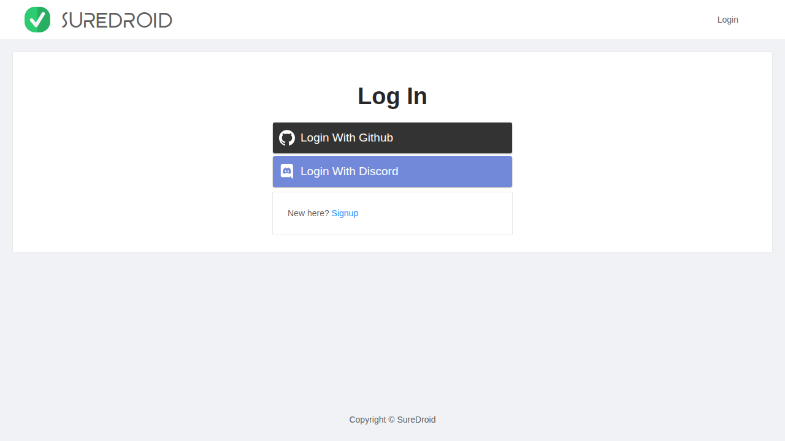

# ProjectManager

I built ProjectManager to get the project list and the work inside each project into one place. It grew into a React client with project and account views, and an Express and Apollo GraphQL service backed by MongoDB.

**Archived prototype · Partially complete**



## How it fits together

- `client/` contains the React UI, sign-in, and the views used to list and edit projects.
- `server/` contains the Express service, GraphQL endpoints, and database code.
- `docker-compose.dev.yml` describes the original client, server, and MongoDB development stack.

## Run the archived client

The client build was reproduced with Node.js 12.22.12 and the checked-in npm lockfile. This is a legacy runtime for the archive. Run it in an isolated environment.

```sh
cd client
npm ci
npm run build
```

The build writes to `client/build/`. Use an SPA-capable server to serve it and open `/login` to see the screen above. Run the historical development stack with `npm run dev:up` from the repository root when you have the required services configured. Use local test credentials and a separate database.

## Archive notes

The source snapshot is anchored to the January 17, 2020 project history. This README and the screenshot were prepared during the later migration. The original development and site branches remain in the repository history.
